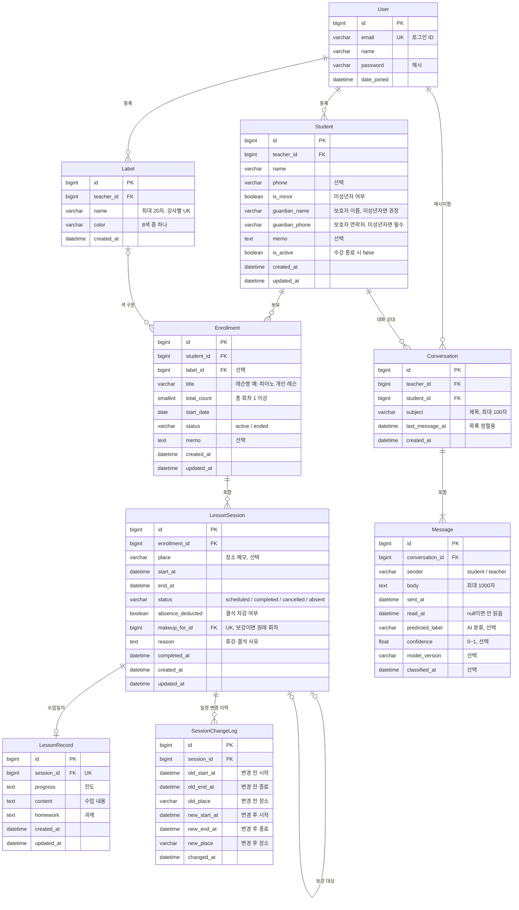

# LEMIT 데이터 모델 (ERD)

> **상태: 확정 (2026-11-18, 2026-11-19 장소 메모·#2 규칙·메시지함(2-10) 반영)** · 관련 이슈: #1 · 변경 시 이 문서를 먼저 고치고 devlog에 기록
> 기준 문서: [USE_CASES.md](USE_CASES.md), [README 회차 규칙](../README.md#회차-상태와-차감-규칙), [PROJECT_PLAN.md §8](PROJECT_PLAN.md)

## 1. 전체 구조



| 모델 | 뜻 | 단계 | 유스케이스 |
|---|---|---|---|
| `User` | 강사 계정 | MVP | UC-01 |
| `Student` | 수강생 | MVP | UC-02 |
| `Enrollment` | 레슨권 (예: 피아노 8회) | MVP | UC-03, UC-07 |
| `LessonSession` | 수업 1회 (회차) | MVP | UC-04~06, UC-08~11 |
| `LessonRecord` | 회차별 수업일지 | 확장 | UC-14 |
| `SessionChangeLog` | 회차 일정 변경 이력 (바꾸기 전·후 날짜·시간·장소) | 확장 | UC-11 |
| `Label` | 레슨권 색 구분 라벨 (수업 형태·사람) | MVP 후속 | UC-16 |
| `Conversation` | 강사와 수강생 한 명의 대화 스레드 | MVP | UC-17 |
| `Message` | 메시지 1건 + 수강생 메시지의 AI 분류 결과 | MVP | UC-17 |
| `LoginAttempt` | 로그인 실패·비밀번호 재설정 요청 기록 (시도 횟수 제한용, 다른 모델과 연결 없음) | 운영 보안 | UC-01, UC-15 (#7) |

> 장소는 별도 모델 없이 회차의 메모 필드 `LessonSession.place`로 받습니다 (2-8). `Location` 모델은 프로젝트 기간 이후 지도 연동(UC-13) 때 추가합니다.

## 2. 핵심 설계 결정

### 2-1. 회차 상태는 4개, "보강"은 상태가 아니라 연결로 표현

초기 규칙 초안에는 5개 상태(예정/완료/휴강/결석/보강)가 있었지만 **보강은 별도 상태로 두지 않습니다.** 보강 회차도 예정 → 완료로 똑같이 진행되기 때문입니다. 대신 `makeup_for`로 원래 회차를 가리키면 보강 회차입니다.

| `status` 값 | 화면 표시 | 차감 |
|---|---|---|
| `scheduled` | 예정 | ✗ |
| `completed` | 완료 | ✓ |
| `cancelled` | 휴강 | ✗ |
| `absent` | 결석 | `absence_deducted`가 true일 때만 ✓ |

- `makeup_for`가 있는 회차 → 화면에 "보강" 배지 표시
- `makeup_for`는 **유일(Unique)** → 휴강·결석 1회에 보강은 1회만 연결 (UC-09 수용 기준)
- 보강 회차는 완료되면 `completed`로 세므로 **보강을 따로 더하지 않습니다** (중복 차감 방지)
- **차감한 결석(`absence_deducted = true`)에는 보강을 연결할 수 없습니다.** 이미 1회 소진된 수업에 보강까지 차감되는 것을 막기 위해서입니다. (#2에서 최종 확정)

### 2-2. 잔여 회차는 저장하지 않고 계산

```text
차감 회차 = completed 수 (보강 회차 포함) + (absent 이면서 absence_deducted = true) 수
잔여 회차 = Enrollment.total_count − 차감 회차
```

- `remaining_count` 같은 컬럼을 두면 상태를 바꿀 때마다 같이 고쳐야 해서 **값이 어긋날 위험**이 있습니다.
- 대신 Django ORM 집계(`annotate` + `Count(filter=...)`)로 매번 계산합니다. 강사 1명의 데이터 규모에서는 성능 문제가 없습니다.
- 이 계산은 `Enrollment`의 메서드·쿼리셋 한 곳에만 두고 단위 테스트합니다. (UC-06, UC-07)
  - 구현: `EnrollmentQuerySet.with_usage()`가 `used_count`(차감 회차)·`remaining_count`(잔여)를 붙이고, `exhausted()`는 잔여 0 이하만 고릅니다 (`lessons/models.py`, 2026-11-20). 잔여는 초과 진행 시 음수가 될 수 있습니다. 레슨권마다 따로 세는 **서브쿼리**로 계산해, 앞뒤에 회차 조건(`filter(sessions__...)`)이 붙어도 차감 회차가 부풀거나 빠지지 않습니다 (PR #55 리뷰 1·2차).

### 2-3. 기획서의 `Lesson` 모델은 MVP에서 `Enrollment`에 합침

기획서 §8은 `Lesson`(수업 단위)과 `Enrollment`(수강생-수업 연결)를 나눴습니다. 그런데 **1:1 개인 레슨**에서는 수업 하나에 수강생이 한 명이라 두 모델이 늘 1:1이 됩니다. 그래서 MVP에서는 레슨명(`title`)을 `Enrollment`에 두고 `Lesson`은 만들지 않습니다.

→ 여러 명이 듣는 그룹 수업·원데이 클래스(장기 확장)를 만들 때 `Class` 모델을 추가하고 `Enrollment`가 그것을 가리키도록 확장합니다.

### 2-4. 커스텀 User 모델로 시작

Django는 **프로젝트 시작 때 커스텀 User 모델을 만들라고 권장**합니다. 나중에 바꾸면 마이그레이션이 매우 어렵기 때문입니다. `AbstractUser`를 상속하고 **이메일로 로그인**하도록 합니다.

### 2-5. 데이터 소유(권한)

- `Student`, `Label`, `Conversation`에만 `teacher_id`를 둡니다. `Conversation`은 메시지함 목록을 강사 기준으로 바로 조회하기 위해 둡니다 (`student.teacher`와 같아야 함, 2-10).
- `Enrollment`, `LessonSession`, `LessonRecord`는 `student.teacher`를 따라가서 소유자를 확인합니다. (같은 정보를 여러 곳에 두지 않음)
- 소유권은 **서버에서 강제**합니다. 화면에서 선택지를 숨기는 것만으로는 조작된 요청을 막을 수 없기 때문입니다.
  1. **조회·수정·삭제:** 모든 뷰는 로그인한 강사의 데이터로 좁힌 쿼리셋에서 객체를 찾습니다. 다른 강사의 객체 번호로 접근하면 404.
  2. **연결(외래키 선택):** 폼의 선택지 쿼리셋을 로그인한 강사 것으로 제한합니다. 조작된 POST로 다른 강사의 `label_id`·`enrollment_id`를 보내면 폼 오류.
  3. **저장 직전:** 모델 `clean()`에서 소유자가 같은지 다시 확인합니다 (예: `Enrollment.label.teacher == Enrollment.student.teacher`).
  4. **테스트:** 강사 A·B 두 계정으로 서로의 데이터를 조회·수정·삭제·연결할 수 없는지 앱마다 격리 테스트를 둡니다.
- 구현 방식은 [SCREENS.md §7](SCREENS.md)에 정리했습니다.

### 2-6. 시간은 `datetime` + Asia/Seoul

- 회차는 날짜와 시간을 따로 두지 않고 `start_at`, `end_at`(시간대 포함 datetime)으로 저장합니다.
- 주간 조회, 겹침 검사, 정렬이 간단해집니다.
- 설정: `USE_TZ = True`, `TIME_ZONE = "Asia/Seoul"`

### 2-7. 미성년자 수강생은 보호자 연락처를 받음

- 생년월일 대신 **미성년자 여부(`is_minor`)만** 받습니다. 나이를 계산할 필요가 없고, 개인정보를 최소한으로 수집하기 위해서입니다.
- `is_minor = true`이면 **보호자 연락처(`guardian_phone`)가 필수**입니다. 보호자 이름은 선택입니다.
- 학생 본인 연락처(`phone`)는 항상 선택입니다. 어린 학생은 휴대폰이 없을 수 있기 때문입니다.
- 보호자를 별도 모델로 두지 않습니다. 학부모용 화면(장기 확장)을 만들 때 `Guardian` 모델로 분리를 검토합니다.

### 2-8. 장소는 회차마다 적는 메모로 받음 (2026-11-19)

- `LessonSession.place`(최대 100자, 선택)에 "A 레슨실", "○○초 음악실"처럼 자유롭게 적습니다.
- 장소를 미리 등록하는 `Location` 모델과 장소 관리 화면은 만들지 않습니다. 개인 강사에게는 장소를 따로 등록하는 것보다 바로 적는 편이 빠르기 때문입니다.
- **프로젝트 기간 이후 지도 연동**(주소 검색·지도 표시)을 할 때 `Location` 모델을 추가하고, 그동안 쌓인 `place` 메모를 등록 장소로 옮길 수 있게 확장합니다 (UC-13).
- 메모 단계에서는 장소를 표시만 하고, 장소별 필터·통계는 지도 연동 때 제공합니다.

### 2-9. 라벨은 레슨권에 하나, 색은 정해진 8색 (2026-11-19)

- 화면에서 **색은 라벨 전용, 상태는 모양**으로 표시합니다 ([SCREENS.md §4](SCREENS.md)). 그래서 상태에는 색 필드가 없고, 색은 `Label.color` 하나뿐입니다.
- 라벨을 `Enrollment`(수강생 × 수업)에 붙여, 수업 형태 구분(`피아노`, `출강`)과 사람 구분(수강생 이름 라벨)을 한 모델로 모두 지원합니다.
- 레슨권당 라벨은 **하나**(`ForeignKey`, 선택)입니다. 여러 개를 허용하면 달력 점·색 막대를 어떤 색으로 그릴지 정할 수 없기 때문입니다.
- `color`는 `red / orange / yellow / green / teal / blue / purple / brown` 중 하나(`TextChoices`)로 저장하고, 실제 색값은 CSS 변수로 둡니다. 다크 모드나 색 조정 때 데이터를 고칠 필요가 없습니다.

### 2-10. 메시지는 대화 스레드로 묶고, AI 분류 결과는 메시지에 저장 (2026-11-19)

- 강사와 수강생이 메일처럼 주고받는 구조입니다. **대화(`Conversation`) 하나 = 강사 1 × 수강생 1 × 제목 1**이고, 메시지(`Message`)가 시간순으로 쌓입니다.
- `sender`로 보낸 사람(`student`/`teacher`)을 구분합니다. 수강생 계정이 없는 MVP에서는 강사가 시연용으로 수강생 메시지를 대신 등록합니다(UC-17 A안). 나중에 수강생 링크나 계정이 생겨도 구조는 그대로입니다.
- **AI 분류는 수강생 메시지에만** 저장합니다(`predicted_label`, `confidence`, `model_version`, `classified_at`). 강사 메시지와 분류 실패 메시지는 비워둡니다. 모델이 없어도 메시지는 저장되어야 하기 때문입니다.
- `predicted_label`은 `CANCELLATION / MAKEUP / RESCHEDULE / GENERAL` 중 하나(`TextChoices`)입니다. 값은 `ml/labels.py`와 같아야 합니다.
- `model_version`을 같이 저장해, 모델을 바꾼 뒤에도 어떤 모델이 낸 결과인지 추적합니다.
- 예측은 참고용이라 회차(`LessonSession`)와 자동으로 연결하거나 상태를 바꾸지 않습니다. 메시지를 특정 회차와 연결하는 필드는 필요가 확인되면 추가합니다.
- 모델 설계·데이터·한계는 [ML.md](ML.md)에 있습니다.

### 2-11. 로그인 시도 기록은 계정과 연결하지 않음 (2026-11-22, #7)

- `LoginAttempt(kind, email, ip, created_at)`: 로그인 실패와 비밀번호 재설정 요청을 남겨 시도 횟수를 제한합니다 (`accounts/throttle.py`).
- `User`와 외래키로 잇지 않고 **입력한 이메일(소문자)** 을 그대로 둡니다. 없는 이메일도 같은 방식으로 세어야 가입 여부가 드러나지 않기 때문입니다.
- 규칙: 최근 15분 동안 같은 이메일 실패 5번 또는 같은 IP 실패 20번이면 막습니다.
- 로그인에 성공하면 그 이메일의 **확정된** 실패(`pending=False`)를 `email_cleared=True`로 표시해 **이메일 집계에서만** 뺍니다. 행은 남아 IP 집계에는 계속 들어갑니다(PR #70 리뷰).
- 비밀번호 확인 중인 로그인 예약은 `pending=True`입니다. 같은 이메일의 다른 요청이 그사이 성공해도 초기화되지 않고, 실패로 끝나면 확정된 실패로 남습니다(PR #70 재검토).
- 여러 gunicorn worker가 같은 기록을 보도록 프로세스 메모리 캐시가 아니라 DB에 둡니다.
- 검사와 기록은 이메일·IP별 PostgreSQL advisory lock(`pg_advisory_xact_lock`) 안에서 한 번에 합니다. 로그인은 비밀번호 확인 전에 한 칸을 예약하고 성공하면 반납하므로, 동시 요청도 한도까지만 통과합니다(PR #70 리뷰).
- 개인정보(IP·이메일)를 오래 두지 않도록 새 기록을 남길 때 하루가 지난 행을 지웁니다.

## 3. 제약 조건

| 대상 | 규칙 | 구현 위치 |
|---|---|---|
| `User.email` | 대소문자를 무시하고 유일 (로그인도 대소문자 무시) | DB `UniqueConstraint(Lower(email))` + 회원가입 폼 검증 (UC-01, 2026-11-19) |
| `User.email` = `demo@example.com` | 시연용 데모 계정(`seed_demo`) 전용. 일반 회원가입 불가. `seed_demo`는 Django 그룹 `lemit-demo`가 있는 계정만 데모로 다루고, 표시 없는 같은 이메일 계정이 있으면 아무것도 바꾸지 않고 멈춤 | 회원가입 폼 검증 + 명령의 그룹 확인 (#24, PR #65 리뷰) |
| `Student` | `is_minor`이면 `guardian_phone` 필수 | DB `CheckConstraint` + 폼 검증 |
| `Student.phone`, `guardian_phone` | 숫자 9~15자리. 숫자·공백·`-`·`()`만, `+`는 맨 앞(국제번호 허용). 성인이면 보호자 정보는 저장하지 않음 | 모델 검증 `validate_phone` + 폼 (UC-02, PR #37 리뷰, 2026-11-19) |
| `Enrollment.total_count` | 1 이상 | DB `CheckConstraint` |
| `LessonSession` | `end_at > start_at` | DB `CheckConstraint` |
| `LessonSession.absence_deducted` | `absent`일 때만 true일 수 있음 (다른 상태에서 true로 남으면 잔여 계산이 어긋남) | DB `CheckConstraint` (UC-03 구현 때 추가, 2026-11-20) |
| `LessonSession.makeup_for` | 유일 (보강 1:1) | DB `OneToOneField` |
| `LessonSession.makeup_for` | 원래 회차는 `cancelled` 또는 미차감 `absent`(`absence_deducted = false`)여야 함. 보강이 연결된 뒤 원래 회차를 다른 상태(차감 결석·완료 등)로 바꾸는 것도 거절 | 앱 검증 (모델 `clean`, PR #55 리뷰) |
| `LessonSession` 삭제 | `scheduled` 상태만 가능 | 앱 검증 (UC-04) |
| `SessionChangeLog` | 예정 회차 수정에서 날짜·시간·장소 중 하나라도 바뀔 때만 1건 생성(레슨권만 옮기면 없음). 변경 전 값은 수강생 행·회차 행을 잠근 뒤 다시 읽은 값. 화면에서는 읽기만(관리자 화면도 추가·수정 불가) | 앱 (회차 수정 저장과 같은 트랜잭션, UC-11, 2026-11-22) |
| `LessonRecord.session` | 회차당 일지 1개 | DB `OneToOneField` |
| `LessonSession` 완료 취소 | `completed` → `scheduled`만 가능, `completed_at`을 비움. **수업일지(`LessonRecord`)가 있으면 불가**(일지 모델은 UC-14에서 추가, 그때 조건 추가). 보관된 수강생의 회차는 불가 | 앱 검증 (UC-06, 2026-11-20 구현: 수강생 행 잠금 안에서 `예정`/`완료`일 때만 조건부 갱신) |
| `LessonSession` 결석 처리 | 차감 여부(`absence_deducted`)를 반드시 선택. 폼에 기본값 없음 | 폼 검증 (UC-10) |
| `Enrollment.status` | 잔여 0이어도 자동으로 `ended`가 되지 않음. 종료는 강사가 직접 | 앱 (UC-03, UC-07) |
| `LessonSession` 완료 처리 | 시작 전 회차도 완료 가능하되 확인을 받음 | 화면 (UC-06) |
| 잔여 초과 일정 | 저장 후 `예정` 회차 수(새 회차 포함) > 잔여 회차이면 경고만 (저장 허용) | 앱 검증 (UC-04, UC-12) |
| `Student` 보관 | `is_active=false`로 바꿀 때 남은 `scheduled` 회차를 확인 후 삭제. 다른 상태 회차는 보존 | 앱 (UC-02) |
| `Label` | 같은 강사 안에서 `name` 유일, `color`는 8색 중 하나 | DB `UniqueConstraint(teacher, name)` + `choices` |
| `Label` 조회·수정·삭제 | 로그인한 강사의 라벨만. 다른 강사 라벨은 404 | 뷰 쿼리셋 (UC-16) |
| `Enrollment.label` | 같은 강사의 라벨만 연결 | 폼 선택지 제한 + 모델 `clean()` 재검증 + 격리 테스트 (2-5, UC-16) |
| `Conversation` | `student.teacher == teacher`. 다른 강사의 대화는 404 | 폼 선택지 제한 + 모델 `clean()` + 뷰 쿼리셋 + 격리 테스트 (UC-17) |
| `Message.body` | 공백만 있는 메시지 불가 | 폼 검증 (UC-17) |
| `Message` AI 분류 | `sender = teacher`이면 분류 필드 4개(`predicted_label`, `confidence`, `model_version`, `classified_at`)를 모두 비움. 분류 결과로 일정·상태를 바꾸지 않음 | DB `CheckConstraint`(강사 메시지 분류 금지, 4개 필드 모두) + 앱 (UC-17, PR #38 리뷰) |
| `Message.confidence` | 0 이상 1 이하 | DB `CheckConstraint` (UC-17) |
| `Conversation` | (강사, 수강생, 제목) 유일. 같은 강사·수강생·제목이면 새 대화를 만들지 않고 이어 붙임(동시 요청에도 중복 없음) | DB `UniqueConstraint` + `get_or_create` (UC-17, PR #38 리뷰) |
| 시간 겹침 | 같은 강사의 회차가 겹치면 **경고만** (저장 허용) | 앱 검증 (UC-04) |

**동시 변경 규칙 (PR #55 리뷰, 2026-11-20)**

- 잔여 회차·레슨권 상태를 바꾸는 쓰기는 **같은 수강생 행을 `select_for_update`로 잠근 트랜잭션** 안에서 최신 상태를 다시 읽고 판단합니다. 공통 진입점은 `lessons.services.lock_student()`입니다. 현재 적용: 레슨권 등록(소진 레슨권 종료 포함), 레슨권 직접 종료, 수강생 보관(남은 예정 회차 삭제 포함), **회차 등록·수정·삭제(UC-04)**, **완료 처리·완료 취소(UC-06)**.
- 완료 처리·완료 취소는 상태 조건을 건 갱신(`예정`일 때만 완료, `완료`일 때만 취소)이라 같은 회차를 두 번 눌러도 한 번만 차감합니다. 이 보장은 행 단위 조건부 갱신에서 나오고, 수강생 잠금은 다른 쓰기와 순서를 맞추는 공통 규칙입니다.
- 회차 저장은 잠금 안에서 수강생 보관 여부, 레슨권 진행 중 여부, (수정·삭제면) 회차가 아직 `예정`인지를 다시 확인하고, 하나라도 바뀌었으면 저장·삭제하지 않습니다. 회차 수정은 같은 수강생의 레슨권으로만 옮길 수 있습니다(UC-04, 2026-11-20).
- **이후 구현 조건:** 회차 완료·완료 취소(UC-06), 휴강·보강 연결(UC-08·09), 결석 처리(UC-10)도 같은 잠금을 씁니다. 특히 보강 연결과 원래 회차 상태 변경은 같은 트랜잭션에서 원래 회차를 잠근 뒤 `can_have_makeup()`을 다시 확인해야 동시 요청으로 두 번 차감되지 않습니다.
- 수정 화면은 폼이 다루는 필드만 저장합니다(`update_fields`). 객체 전체를 저장하면 다른 탭에서 바꾼 값(예: 보관, 회차 상태·사유)을 예전 값으로 되돌립니다. 수강생 수정, 회차 수정에 적용.
- **알려진 한계:** Django 관리자(운영자 전용)의 회차 수정·삭제는 이 잠금을 쓰지 않습니다. 관리자에서 삭제 확인과 실제 삭제 사이에 회차가 완료되면 완료 회차가 지워질 수 있으므로, 운영 중에는 관리자에서 회차를 고치지 않습니다.

**삭제 정책 (기록 보존)**

| 관계 | `on_delete` | 이유 |
|---|---|---|
| User → Student | `PROTECT` | 강사 계정을 지워도 수강생·수업 기록이 함께 지워지지 않게 (UC-02) |
| Student → Enrollment | `PROTECT` | 수강생은 삭제 대신 `is_active=false`로 보관 |
| User → Label | `CASCADE` | 라벨은 강사 개인 설정이라 계정과 함께 정리 (수강생이 있으면 User→Student `PROTECT`로 계정 삭제 자체가 막힘) |
| Label → Enrollment | `SET_NULL` | 라벨을 지우면 레슨권은 "라벨 없음"(회색), 기록은 유지 |
| Enrollment → LessonSession | `PROTECT` | 진행 이력이 사라지지 않게 |
| LessonSession → LessonRecord | `CASCADE` | 회차와 일지는 운명을 같이함 |
| LessonSession → SessionChangeLog | `CASCADE` | 이력은 회차에 딸린 기록. 삭제할 수 있는 회차는 예정뿐이라 완료·휴강·결석 회차의 이력은 남음 |
| LessonSession → makeup_for | `SET_NULL` | 원래 회차가 없어져도 보강 기록은 유지 |
| User → Conversation | `PROTECT` | 강사 계정을 지워도 대화 기록이 함께 지워지지 않게 (UC-17) |
| Student → Conversation | `PROTECT` | 수강생은 보관(`is_active=false`)만 하므로 대화 기록 유지 |
| Conversation → Message | `CASCADE` | 대화와 메시지는 운명을 같이함 |

**인덱스**
- `LessonSession(enrollment_id, start_at)`: 레슨권별 회차 이력
- `LessonSession(start_at)`: 주간 일정 조회 (UC-05)
- `SessionChangeLog(session_id, changed_at)`: 회차 상세의 변경 이력 최신순
- `Student(teacher_id, is_active, name)`: 수강생 목록·검색 (UC-02)
- `Conversation(teacher_id, last_message_at)`: 메시지함 목록 (UC-17)
- `Message(conversation_id, sent_at)`: 대화 상세

## 4. 단계별 구현 범위

구현 순서는 발표(11/24) 시연에 필요한 것부터입니다. 세부 우선순위는 GitHub 라벨을 따릅니다.

| 단계 | 유스케이스 | 만들 것 |
|---|---|---|
| **MVP 핵심** (먼저) | UC-01~07, UC-17 | `User`, `Student`, `Enrollment`, `LessonSession`(상태는 `scheduled`/`completed`만 사용해도 동작), `Conversation`·`Message`(과제 조건인 ML 추론 기능) |
| MVP 후속 (핵심 완료 후) | UC-08·09, UC-15, UC-16 | `LessonSession`의 `cancelled`·`makeup_for` 사용(휴강·보강), 비밀번호 찾기(모델 변경 없음), `Label` 화면 |
| 확장 | UC-10, UC-11, UC-14 | `absent` + `absence_deducted`, 일정 변경 이력 `SessionChangeLog`(2026-11-22 추가), `LessonRecord` |
| 이후 | 반복 규칙 `RecurrenceRule`(UC-12), 그룹 수업 `Class`, 장소 `Location` + 지도 연동(UC-13, 프로젝트 이후) |

필드는 MVP 핵심 때 미리 만들어 두고(`place`, `makeup_for`, `label` 등은 비워둘 수 있게, `Label` 모델 포함), 화면 기능만 단계적으로 붙입니다. 마이그레이션 횟수를 줄이기 위해서입니다. 라벨이 없으면 회차는 회색으로 보일 뿐 핵심 흐름은 그대로 동작합니다.

## 5. 결정 기록

- [x] 설계 결정 2-1~2-6 확정 (2026-11-18)
- [x] 미성년자 수강생은 보호자 연락처 필수 (2-7, 2026-11-18)
- [x] 레슨비·결제 정보는 MVP에서 다루지 않음 (기획서 MVP 제외 범위)
- [x] 결석 차감 기본값: 기본값 없이 결석 처리 때 강사가 매번 선택 (#2, 2026-11-19)
- [x] 완료 처리 되돌리기: 허용. 단 수업일지가 있는 회차는 불가 (#2, 2026-11-19)
- [x] 레슨권 소진: 자동 종료하지 않고 '소진' 표시만. 종료는 강사가 직접, 진행 중 레슨권 여러 개 허용 (#2, 2026-11-19)
- [x] 라벨: 레슨권당 하나, 8색 중 선택, 상태는 색 대신 모양으로 표시 (2-9, 2026-11-19)
- [x] 장소: 회차별 자유 메모(`place`), 지도 연동은 프로젝트 이후 (2-8, 2026-11-19)
- [x] 차감한 결석에는 보강 불가 (중복 차감 방지, #2, 2026-11-19)
- [x] 메시지함: 대화 스레드 + 메시지, AI 분류는 수강생 메시지에만 저장, 일정 자동 변경 없음 (2-10, UC-17, 2026-11-19)
- [x] 보강 없는 휴강 회차: "보강 필요" 배지로 표시, 별도 상태·필드 없이 `makeup` 역참조 유무로 판단 (#2, 2026-11-19)
