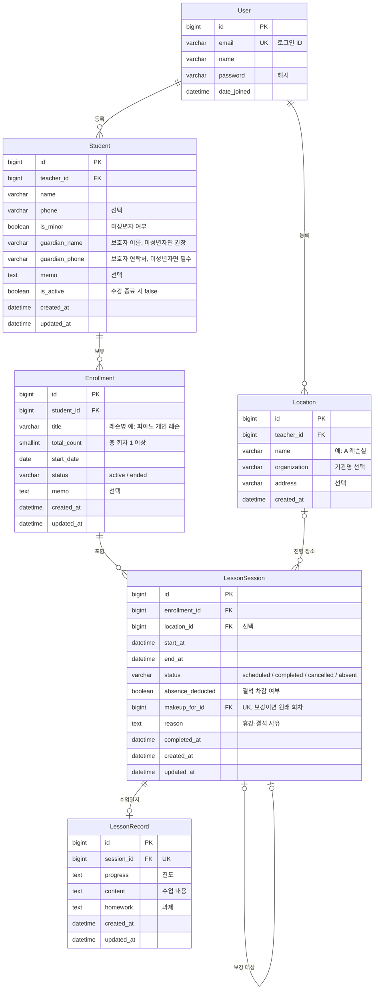

# LEMIT 데이터 모델 (ERD)

> **상태: 확정 (2026-11-18)** · 관련 이슈: #1 · 변경 시 이 문서를 먼저 고치고 devlog에 기록
> 기준 문서: [USE_CASES.md](USE_CASES.md), [README 회차 규칙](../README.md#회차-상태와-차감-규칙-초안), [PROJECT_PLAN.md §8](PROJECT_PLAN.md)

## 1. 전체 구조



| 모델 | 뜻 | 단계 | 유스케이스 |
|---|---|---|---|
| `User` | 강사 계정 | MVP | UC-01 |
| `Student` | 수강생 | MVP | UC-02 |
| `Enrollment` | 레슨권 (예: 피아노 8회) | MVP | UC-03, UC-07 |
| `LessonSession` | 수업 1회 (회차) | MVP | UC-04~06, UC-08~11 |
| `Location` | 레슨실·기관 | 확장 (MVP에선 비워둬도 됨) | UC-13 |
| `LessonRecord` | 회차별 수업일지 | 확장 | UC-14 |

## 2. 핵심 설계 결정

### 2-1. 회차 상태는 4개, "보강"은 상태가 아니라 연결로 표현

README 규칙 초안의 5개 상태(예정/완료/휴강/결석/보강) 중 **보강은 별도 상태로 두지 않습니다.** 보강 회차도 예정 → 완료로 똑같이 진행되기 때문입니다. 대신 `makeup_for`로 원래 회차를 가리키면 보강 회차입니다.

| `status` 값 | 화면 표시 | 차감 |
|---|---|---|
| `scheduled` | 예정 | ✗ |
| `completed` | 완료 | ✓ |
| `cancelled` | 휴강 | ✗ |
| `absent` | 결석 | `absence_deducted`가 true일 때만 ✓ |

- `makeup_for`가 있는 회차 → 화면에 "보강" 배지 표시
- `makeup_for`는 **유일(Unique)** → 휴강·결석 1회에 보강은 1회만 연결 (UC-09 수용 기준)

### 2-2. 잔여 회차는 저장하지 않고 계산

```text
차감 회차 = completed 수 + (absent 이면서 absence_deducted = true) 수
잔여 회차 = Enrollment.total_count − 차감 회차
```

- `remaining_count` 같은 컬럼을 두면 상태를 바꿀 때마다 같이 고쳐야 해서 **값이 어긋날 위험**이 있습니다.
- 대신 Django ORM 집계(`annotate` + `Count(filter=...)`)로 매번 계산합니다. 강사 1명의 데이터 규모에서는 성능 문제가 없습니다.
- 이 계산은 `Enrollment`의 메서드·쿼리셋 한 곳에만 두고 단위 테스트합니다. (UC-06, UC-07)

### 2-3. 기획서의 `Lesson` 모델은 MVP에서 `Enrollment`에 합침

기획서 §8은 `Lesson`(수업 단위)과 `Enrollment`(수강생-수업 연결)를 나눴습니다. 그런데 **1:1 개인 레슨**에서는 수업 하나에 수강생이 한 명이라 두 모델이 늘 1:1이 됩니다. 그래서 MVP에서는 레슨명(`title`)을 `Enrollment`에 두고 `Lesson`은 만들지 않습니다.

→ 여러 명이 듣는 그룹 수업·원데이 클래스(장기 확장)를 만들 때 `Class` 모델을 추가하고 `Enrollment`가 그것을 가리키도록 확장합니다.

### 2-4. 커스텀 User 모델로 시작

Django는 **프로젝트 시작 때 커스텀 User 모델을 만들라고 권장**합니다. 나중에 바꾸면 마이그레이션이 매우 어렵기 때문입니다. `AbstractUser`를 상속하고 **이메일로 로그인**하도록 합니다.

### 2-5. 데이터 소유(권한)

- `Student`, `Location`에만 `teacher_id`를 둡니다.
- `Enrollment`, `LessonSession`, `LessonRecord`는 `student.teacher`를 따라가서 소유자를 확인합니다. (같은 정보를 여러 곳에 두지 않음)
- 모든 화면의 조회는 **로그인한 강사 기준으로 필터링**합니다. 이걸 빠뜨리면 다른 강사의 데이터가 보이므로 테스트로 확인합니다.

### 2-6. 시간은 `datetime` + Asia/Seoul

- 회차는 날짜와 시간을 따로 두지 않고 `start_at`, `end_at`(시간대 포함 datetime)으로 저장합니다.
- 주간 조회, 겹침 검사, 정렬이 간단해집니다.
- 설정: `USE_TZ = True`, `TIME_ZONE = "Asia/Seoul"`

### 2-7. 미성년자 수강생은 보호자 연락처를 받음

- 생년월일 대신 **미성년자 여부(`is_minor`)만** 받습니다. 나이를 계산할 필요가 없고, 개인정보를 최소한으로 수집하기 위해서입니다.
- `is_minor = true`이면 **보호자 연락처(`guardian_phone`)가 필수**입니다. 보호자 이름은 선택입니다.
- 학생 본인 연락처(`phone`)는 항상 선택입니다. 어린 학생은 휴대폰이 없을 수 있기 때문입니다.
- 보호자를 별도 모델로 두지 않습니다. 학부모용 화면(장기 확장)을 만들 때 `Guardian` 모델로 분리를 검토합니다.

## 3. 제약 조건

| 대상 | 규칙 | 구현 위치 |
|---|---|---|
| `Student` | `is_minor`이면 `guardian_phone` 필수 | DB `CheckConstraint` + 폼 검증 |
| `Enrollment.total_count` | 1 이상 | DB `CheckConstraint` |
| `LessonSession` | `end_at > start_at` | DB `CheckConstraint` |
| `LessonSession.makeup_for` | 유일 (보강 1:1) | DB `OneToOneField` |
| `LessonSession.makeup_for` | 원래 회차는 `cancelled` 또는 `absent`여야 함 | 앱 검증 (모델 `clean`) |
| `LessonSession` 삭제 | `scheduled` 상태만 가능 | 앱 검증 (UC-04) |
| `LessonRecord.session` | 회차당 일지 1개 | DB `OneToOneField` |
| 시간 겹침 | 같은 강사의 회차가 겹치면 **경고만** (저장 허용) | 앱 검증 (UC-04) |

**삭제 정책 (기록 보존)**

| 관계 | `on_delete` | 이유 |
|---|---|---|
| Student → Enrollment | `PROTECT` | 수강생은 삭제 대신 `is_active=false`로 보관 |
| Enrollment → LessonSession | `PROTECT` | 진행 이력이 사라지지 않게 |
| Location → LessonSession | `SET_NULL` | 장소를 지워도 회차는 남김 |
| LessonSession → LessonRecord | `CASCADE` | 회차와 일지는 운명을 같이함 |
| LessonSession → makeup_for | `SET_NULL` | 원래 회차가 없어져도 보강 기록은 유지 |

**인덱스**
- `LessonSession(enrollment_id, start_at)`: 레슨권별 회차 이력
- `LessonSession(start_at)`: 주간 일정 조회 (UC-05)

## 4. 단계별 구현 범위

| 단계 | 만들 것 |
|---|---|
| **MVP (P1)** | `User`, `Student`, `Enrollment`, `LessonSession`(상태는 `scheduled`/`completed`만 사용해도 동작) |
| P2 | `LessonSession`의 `cancelled`, `makeup_for` 사용 (휴강·보강) |
| P3 | `absent` + `absence_deducted`, `Location`, `LessonRecord` |
| 이후 | 일정 변경 이력 `SessionChangeLog`(UC-11), 반복 규칙 `RecurrenceRule`(UC-12), 그룹 수업 `Class` |

필드는 MVP 때 미리 만들어 두고(`location`, `makeup_for` 등은 비워둘 수 있게), 화면 기능만 단계적으로 붙입니다. 마이그레이션 횟수를 줄이기 위해서입니다.

## 5. 결정 기록

- [x] 설계 결정 2-1~2-6 확정 (2026-11-18)
- [x] 미성년자 수강생은 보호자 연락처 필수 (2-7, 2026-11-18)
- [x] 레슨비·결제 정보는 MVP에서 다루지 않음 (기획서 MVP 제외 범위)
- [ ] 결석 차감 기본값 (`absence_deducted` 기본값) → #2에서 결정
- [ ] 완료 처리 되돌리기 허용 여부 → #2에서 결정
