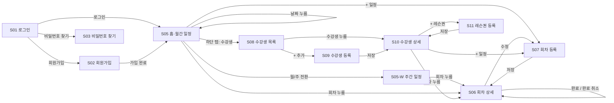

# LEMIT 화면 설계

> **상태: 초안 (2026-11-19)** · 관련 이슈: #23 · 기준: [USE_CASES.md](USE_CASES.md), [ERD.md](ERD.md)
> 발표 MVP(UC-01~07, UC-15)에 필요한 화면만 정의합니다. 확장 기능(UC-08~09)은 버튼 위치만 잡아 둡니다.

## 1. 설계 원칙

- **모바일 우선:** 강사는 이동 중이나 수업 직후 휴대폰으로 완료 처리를 합니다. 폭 360px 기준으로 설계하고, PC에서는 가운데 정렬로 넓게 보여줍니다.
- **홈 = 캘린더 (월간 기본, 주간 전환):** 첫 화면에서 이번 달 전체 흐름과 오늘 수업 목록을 함께 보여줍니다. 가장 자주 하는 일(오늘 수업 확인 → 완료 처리)이 두 번 터치 안에 끝나야 합니다.
- **아이폰 캘린더처럼 깔끔하고 직관적으로:** 여백을 넉넉히 두고, 테두리 대신 얇은 구분선을 쓰며, 강조색은 하나만 씁니다. 자세한 기준은 §5 디자인 가이드에 있습니다. 특정 앱의 화면이나 아이콘을 그대로 베끼지 않고, 단순함·정보 위계 같은 원칙만 참고합니다.
- **상태는 색 + 글자로 구분:** 색만으로 구분하지 않습니다 (색각 이상 고려).
- **상태 변경은 POST로 처리:** 완료·완료 취소·삭제 같은 동작은 링크(GET)가 아니라 폼(POST, CSRF 보호)으로 처리합니다.
- **화면 수 최소화:** 등록과 수정은 같은 폼 화면을 씁니다.

## 2. 화면 목록

| ID | 화면 | URL | 유스케이스 | 비고 |
|---|---|---|---|---|
| S01 | 로그인 | `/accounts/login/` | UC-01 | 로그인하지 않으면 모든 페이지가 여기로 이동 |
| S02 | 회원가입 | `/accounts/signup/` | UC-01 | 가입 후 자동 로그인 → 홈 |
| S03 | 비밀번호 찾기 (4개 화면) | `/accounts/password-reset/…` | UC-15 | Django 기본 뷰: 이메일 입력 / 발송 안내 / 새 비밀번호 / 완료 |
| S04 | 비밀번호 변경 | `/accounts/password-change/` | UC-15 | 로그인 상태 |
| S05 | 홈: 월간 일정 (기본) | `/`, `/?view=month&date=2026-11-19` | UC-05 | 달력 + 선택한 날의 회차 목록 |
| S05-W | 홈: 주간 일정 | `/?view=week&date=2026-11-19` | UC-05 | 같은 화면에서 월/주 전환 |
| S06 | 회차 상세 | `/sessions/<id>/` | UC-06, (UC-08·09) | 상태 변경 버튼 모음 |
| S07 | 회차 등록·수정 | `/sessions/new/`, `/sessions/<id>/edit/` | UC-04 | 겹침·잔여 초과 경고 |
| S08 | 수강생 목록 | `/students/` | UC-02, UC-07 | 잔여 회차·소진 강조 |
| S09 | 수강생 등록·수정 | `/students/new/`, `/students/<id>/edit/` | UC-02 | 미성년자 체크 시 보호자 입력란 표시 |
| S10 | 수강생 상세 | `/students/<id>/` | UC-02, UC-03, UC-07 | 레슨권 카드 + 회차 이력 |
| S11 | 레슨권 등록 | `/students/<id>/enrollments/new/` | UC-03 | 소진된 이전 레슨권 종료 제안, 라벨 선택 |
| S12 | 라벨 관리 (제안) | `/labels/` | (신규) | 라벨 이름·색 추가·수정·삭제. 계정 메뉴에서 진입 |

**화면 없이 처리하는 동작 (POST 후 원래 화면으로 돌아감)**

| 동작 | URL | 유스케이스 |
|---|---|---|
| 완료 처리 | `POST /sessions/<id>/complete/` | UC-06 |
| 완료 취소 | `POST /sessions/<id>/uncomplete/` | UC-06 |
| 회차 삭제 (`예정`만) | `POST /sessions/<id>/delete/` | UC-04 |
| 레슨권 종료 | `POST /enrollments/<id>/end/` | UC-03 |
| 수강생 보관 | `POST /students/<id>/archive/` | UC-02 |
| 로그아웃 | `POST /accounts/logout/` | UC-01 |
| (P2) 휴강 / 보강 등록 | `POST /sessions/<id>/cancel/`, `/sessions/<id>/makeup/new/` | UC-08, UC-09 |

## 3. 화면 흐름



**발표 시연 동선:** S01 로그인 → S08 수강생 목록 → S09 수강생 등록 → S10 상세 → S11 레슨권(8회) → S10 "+ 일정" → S07 → S05 월간 달력에서 일정 확인(주간 전환도 시연) → S06 완료 → S10에서 진행 1 / 잔여 7 확인

## 4. 공통 레이아웃

```text
+------------------------------+
| LEMIT                [계정 v] |  상단: 로고, 계정 메뉴(비밀번호 변경·로그아웃)
+------------------------------+
|                              |
|          (화면 내용)          |
|                              |
+------------------------------+
|     일정      |    수강생     |  하단 탭 (모바일). PC에선 상단 메뉴
+------------------------------+
```

- 처리 결과는 화면 위쪽 알림 메시지(Django messages)로 보여줍니다. 예: "완료 처리했습니다. 잔여 7회"
- 경고(겹침·회차 초과)는 노란색, 오류는 빨간색 알림을 씁니다.

### 회차 표시 체계: 라벨은 색, 상태는 모양 (제안, 2026-11-19)

한 회차에 **"무슨·누구 수업인가"(라벨)**와 **"어떻게 됐나"(상태)** 두 정보를 함께 보여줘야 합니다. 둘 다 색으로 표시하면 서로 섞여 읽기 어려우므로 **역할을 나눕니다.**

| 정보 | 표현 수단 | 누가 정하나 | 예 |
|---|---|---|---|
| 라벨 (수업 형태·사람) | **색**: 목록 왼쪽 색 막대, 달력 점 색 | 강사가 이름·색 지정 | `피아노`(파랑), `출강`(초록), `체험`(주황) |
| 상태 | **모양**: 체크, 흐리게, 취소선, 작은 글자 | 시스템 고정 | 아래 표 |

**상태 표시 (색을 쓰지 않음)**

| 상태 | 표시 |
|---|---|
| 예정 | 기본 모양 그대로 |
| 완료 | 앞에 `✓`, 글자를 회색으로 흐리게 |
| 휴강 | 제목에 취소선 + 작은 회색 글자 `휴강` |
| 결석 | 제목에 취소선 + 작은 회색 글자 `결석·차감` / `결석·미차감` |
| 보강 회차 | 작은 테두리 글자 `보강` (상태와 함께 표시) |
| 보강 필요 | **예외적으로 주황 글자** `! 보강 필요`. 강사가 처리해야 할 일이라 눈에 띄어야 함 |

```text
| 11월 19일 수요일                     |
| ▌ 15:00  이도윤 · 바이올린           |  ▌ = 라벨 색 막대 (파랑: 바이올린)
| ▌ ✓ 13:00  김하늘 · 피아노  (흐리게) |  완료
| ▌ 10:00  ~~박서연 · 피아노~~  휴강   |  휴강, 아래 줄에 "! 보강 필요"
| ▌ 17:30  정민아 · 체험  [보강]       |  보강 회차, 라벨 주황
```

**라벨을 어디에 붙이나: 레슨권**

- 레슨권(`Enrollment`)은 "누구(수강생) × 어떤 수업(레슨명)"의 묶음이라, 라벨을 여기에 붙이면 **수업 형태와 사람 구분을 모두** 할 수 있습니다.
  - 수업 형태로 쓰는 강사: `피아노`, `바이올린`, `출강`, `체험` 같은 라벨을 만들어 레슨권마다 고름
  - 사람으로 구분하고 싶은 강사: 수강생 이름으로 라벨을 만들어 그 수강생의 레슨권에 붙임
- 사람 이름은 라벨과 상관없이 **항상 글자로 표시**되므로, 라벨이 없어도 누구 수업인지는 알 수 있습니다.
- 라벨은 선택입니다. 라벨이 없는 레슨권은 회색으로 표시합니다.

**라벨 규칙**

- 이름(최대 20자)과 색(정해진 8색: 빨강·주황·노랑·초록·청록·파랑·보라·갈색 중 하나)
- 색을 자유롭게 고르게 하지 않는 이유: 너무 연한 색처럼 잘 안 보이는 색을 막고, 다크 모드에서도 같은 8색의 어두운 버전으로 바꾸기 쉬움
- 강사마다 따로 관리하며, 같은 이름의 라벨은 만들 수 없음
- 라벨을 지우면 그 라벨을 쓰던 레슨권은 "라벨 없음"(회색)이 됨. 회차 기록은 그대로
- 달력에서 라벨별로 걸러 보기 (수강생 필터와 함께)

**달력의 점:** 그날 회차의 라벨 색 점을 최대 3개까지 표시합니다. 같은 라벨은 점 하나로 합칩니다.

## 5. 디자인 가이드

아이폰 기본 캘린더처럼 **정보가 적고, 한눈에 읽히고, 누를 곳이 분명한** 화면을 목표로 합니다.

| 항목 | 기준 |
|---|---|
| 글꼴 | 시스템 글꼴 (`-apple-system, BlinkMacSystemFont, "Apple SD Gothic Neo", "Malgun Gothic", sans-serif`). 웹폰트를 내려받지 않아 빠르고, 기기마다 익숙한 글꼴로 보임 |
| 배경 | 흰색 바탕, 묶음(카드·목록) 사이만 아주 연한 회색(`#F2F2F7` 계열) |
| 구분 | 상자 테두리 대신 얇은 회색 구분선(1px) |
| 강조색 | **하나만** 사용: 오늘 날짜 원, 주 버튼, 선택된 탭. 빨강 계열(`#E5484D` 안) |
| 라벨색 | 강사가 고른 라벨 8색은 목록 색 막대·달력 점에만 사용. 상태는 색 대신 모양으로 표시 (§4 회차 표시 체계) |
| 글자 위계 | 화면 제목(달 이름)만 크고 굵게(28px), 본문 17px, 보조 정보(장소·잔여) 15px 회색 |
| 터치 영역 | 버튼·목록 줄 높이 최소 44px |
| 화면 이동 | 위쪽 왼쪽 `< 이전 화면` 글자 버튼, 주 동작은 오른쪽 위 `+` |
| 확인 창 | 삭제·보관 같은 되돌리기 어려운 동작만 확인 창, 나머지는 바로 실행 후 알림 메시지 |
| 다크 모드 | 휴대폰 설정을 따라 자동 전환 (CSS 변수로 색을 정의해 두면 추가 작업이 적음). 발표 후 해도 됨 |

**CSS 방식:** 프레임워크 없이 **직접 작성**합니다. 위 기준을 CSS 변수(색·간격·글자 크기) 한 곳에 모아 두고, 공통 스타일 파일 하나(`static/css/app.css`)로 관리합니다. 달력 격자처럼 프레임워크가 제공하지 않는 화면이 핵심이고, 프레임워크의 기본 디자인이 원하는 깔끔한 스타일과 달라서 덮어쓰는 수고가 더 크기 때문입니다.

## 6. 화면별 와이어프레임

### S01 로그인 / S02 회원가입

```text
+------------------------------+
|            LEMIT             |
|    수업의 모든 흐름을 하나로    |
|                              |
| 이메일    [                ] |
| 비밀번호  [                ] |
|                              |
| [          로그인          ] |
|                              |
|    비밀번호 찾기 · 회원가입    |
+------------------------------+
```

- S02는 이메일·이름·비밀번호·비밀번호 확인 4칸. 이미 가입된 이메일이면 입력란 아래 오류 표시.

### S05 홈: 월간 일정 (기본)

```text
+------------------------------+
| 2026년                 오늘  + |  오늘: 오늘 날짜로 이동, +: 일정 추가
| 11월                   <   >  |  달 이름 크게, < >로 이전·다음 달
|       [   월   |   주   ]     |  월/주 전환 (세그먼트 버튼)
+------------------------------+
|  일  월  화  수  목  금  토    |  일요일은 회색
|                          1    |
|                               |
|   2   3   4   5   6   7   8   |
|       .       .       .       |  회차가 있는 날 아래 점
|   9  10  11  12  13  14  15   |
|       .       .       .       |
|  16  17  18 (19) 20  21  22   |  (19) = 오늘: 강조색 원 안에 흰 숫자
|       .   .   .   .           |  선택한 날: 검은 원 (오늘이 아니면)
|  23  24  25  26  27  28  29   |
|       .       .       .       |
|  30                           |
+------------------------------+
| 11월 19일 수요일               |  선택한 날의 회차 목록
|                               |
| 15:00  이도윤 · 바이올린   예정 |
| 16:00  OO초 음악실            |  종료 시각·장소는 회색 작은 글자
| ----------------------------- |
| 17:30  박서연 · 피아노     예정 |
| 18:30                         |
+------------------------------+
| 수강생: [전체 v]               |  필터 (월·주 공통)
+------------------------------+
```

- 처음 열면 이번 달 + 오늘이 선택된 상태. 오늘 수업이 바로 아래 보여서 "회차 누름 → 완료" 두 번이면 끝남.
- 날짜를 누르면 그날 목록으로 바뀜 (`?view=month&date=2026-11-21`). 페이지 새로고침 방식이라 JS 없이 동작.
- 점은 그날 회차의 **라벨 색**으로 최대 3개까지 표시합니다 (같은 라벨은 하나로). 개수·상태는 목록에서 확인합니다.
- 목록의 각 줄은 왼쪽에 라벨 색 막대, 상태는 모양으로 표시합니다 (§4 회차 표시 체계).
- 일정이 없는 날을 누르면 "일정 없음" + `일정 추가` 버튼 (그 날짜로 미리 채워진 S07로 이동).
- 휴대폰에서 좌우로 밀어 달을 넘기는 동작은 발표 후 추가 (먼저 `< >` 버튼으로).

### S05-W 홈: 주간 일정

```text
+------------------------------+
| 2026년                 오늘  + |
| 11월 16일 - 22일       <   >  |
|       [   월   |   주   ]     |
+------------------------------+
| 11/18 (화)                    |
|  16:00 김하늘 · 피아노  ✓ 완료 |
|        A 레슨실               |
+------------------------------+
| 11/19 (수) 오늘               |  오늘은 강조 배경
|  15:00 이도윤 · 바이올린  예정 |
|        OO초 음악실            |
|  17:30 박서연 · 피아노    예정 |
+------------------------------+
| 11/20 (목)   일정 없음         |
+------------------------------+
|             ...              |
|                     [+ 일정] |  화면에 떠 있는 버튼
+------------------------------+
```

- 회차 한 줄: 시간, 수강생 이름 · 레슨명, 상태 배지, 장소 메모(있을 때만)
- 줄을 누르면 S06. 보관된 수강생의 회차는 표시하지 않음 (기록은 수강생 상세에서 확인)

### S06 회차 상세

```text
+------------------------------+
| < 일정                        |
| 이도윤 · 바이올린 개인 레슨     |
| 11/19 (수) 15:00 - 16:00      |
| 장소: OO초 음악실              |
| 상태: 예정                     |
| 레슨권: 진행 3 / 잔여 5 (총 8) |
+------------------------------+
| [        ✓ 완료 처리        ] |  예정일 때 주 버튼
| [ 휴강 ]  [ 결석 ]   (P2·P3)  |
+------------------------------+
| 수정 · 삭제                    |  삭제는 예정 상태만 표시
+------------------------------+
```

- 완료 상태: 주 버튼 자리에 "완료 취소" (수업일지가 있으면 숨김)
- 시작 전 회차에서 완료를 누르면 "아직 시작 전인 수업입니다. 완료할까요?" 확인
- 잔여 0인 레슨권이면 완료 후 "회차 초과" 경고 메시지

### S07 회차 등록·수정

```text
+------------------------------+
| < 일정 추가                    |
| 수강생·레슨권 [김하늘·피아노 v] |  진행 중 레슨권만. 수강생 상세에서 오면 미리 선택
| 날짜      [2026-11-21]        |
| 시작 [16:00]   종료 [17:00]   |
| 장소 메모 [A 레슨실         ] |  선택, 최대 100자
|                              |
| ! 같은 시간에 박서연 회차가     |  저장을 누르면 경고 표시,
|   있습니다.  [그래도 저장]     |  "그래도 저장"으로 확정
|                              |
| [           저장           ] |
+------------------------------+
```

- 종료가 시작보다 이르면 오류(저장 안 됨). 겹침·잔여 초과는 경고(확인 후 저장).
- 종료 시간 기본값: 시작 + 1시간

### S08 수강생 목록

```text
+------------------------------+
| 수강생                [+ 추가] |
| [이름 검색       ] [ ] 보관 포함|
+------------------------------+
| 김하늘       피아노    잔여 7/8 |
| 이도윤       바이올린  잔여 5/8 |
| 박서연  !    피아노    잔여 2/8 |  2회 이하 강조
| 최준호  소진  기타      0/4    |  소진 배지
| 정민아       (레슨권 없음)      |
+------------------------------+
```

- 진행 중 레슨권이 여러 개면 레슨권별로 한 줄씩 표시

### S09 수강생 등록·수정

```text
+------------------------------+
| < 수강생 추가                  |
| 이름 *      [             ]   |
| 연락처      [             ]   |
| [ ] 미성년자                   |
|   보호자 연락처 * [         ]  |  체크했을 때만 표시
|   보호자 이름     [         ]  |
| 메모        [             ]   |
| [           저장           ] |
+------------------------------+
```

- 보호자 입력란 표시·숨김은 짧은 JS로 처리. JS가 꺼져 있어도 서버 검증으로 막힘.

### S10 수강생 상세

```text
+------------------------------+
| < 수강생                 수정 |
| 박서연  (미성년자)              |
| 보호자 010-0000-0000          |
+------------------------------+
| 레슨권                [+ 추가] |
|  피아노 개인 레슨 (진행 중)     |
|  총 8 · 진행 6 · 잔여 2   !   |
|  시작 2026-10-01      [종료]   |
| > 종료된 레슨권 1개            |  접힘
+------------------------------+
| 보강 필요 (P2)                 |  해당 회차가 있을 때만
+------------------------------+
| 회차 이력             [+ 일정] |
| 11/19 17:30  예정             |
| 11/12 17:30  ✓ 완료           |
| 11/05 17:30  ✓ 완료           |
| ...                          |
+------------------------------+
| 수강 종료(보관)                 |
+------------------------------+
```

- 보관을 누르면 "예정 회차 N개가 삭제됩니다. 보관할까요?" 확인
- 회차 이력은 최신순, 레슨권별로 묶어 표시

### S11 레슨권 등록

```text
+------------------------------+
| < 박서연 · 레슨권 추가          |
| 레슨명   [피아노 개인 레슨   ]  |
| 총 회차  [ 8 ]                 |
| 시작일   [2026-11-19]          |
| 라벨     [● 피아노 v]          |  선택. 목록 맨 아래 "+ 새 라벨"로
|                              |  이름·색을 바로 만들 수 있음
| [v] 소진된 '피아노 개인 레슨'   |  소진된 진행 중 레슨권이
|     (0/8)을 종료합니다         |  있을 때만, 기본 체크
| [           저장           ] |
+------------------------------+
```

### S12 라벨 관리 (제안)

```text
+------------------------------+
| < 설정 · 라벨          + 추가 |
+------------------------------+
| ● 피아노            레슨권 3  |  ● = 라벨 색
| ● 바이올린          레슨권 1  |
| ● 출강              레슨권 2  |
| ● 체험              레슨권 0  |
+------------------------------+

라벨 추가·수정
| 이름 [출강              ]     |
| 색   ● ● ● ● ● ● ● ●         |  8색 중 하나 선택 (선택된 색에 체크)
| [           저장           ] |
| 삭제                          |  삭제 시 "레슨권 2개가 라벨 없음이 됩니다" 확인
```

## 7. Django 앱 구조

| 앱 | 모델 | 화면 |
|---|---|---|
| `accounts` | `User` | S01~S04, 로그아웃 |
| `students` | `Student` | S08~S10, 보관 |
| `lessons` | `Enrollment`, `LessonSession`, `Label`(제안) (이후 `LessonRecord`) | S05~S07, S11, S12, 상태 변경 동작 |

- `Enrollment`는 잔여 회차 계산이 `LessonSession`과 붙어 있어 `lessons`에 둡니다.
- S11 URL은 수강생 아래(`/students/<id>/enrollments/new/`)지만 뷰는 `lessons` 앱에 둡니다.
- 모든 뷰는 `LoginRequiredMixin` + 로그인한 강사 기준 쿼리셋 필터를 적용합니다 (ERD 2-5).

## 8. 결정 기록

- [x] 모바일 우선 (2026-11-19)
- [x] 홈은 월간 달력 + 선택한 날 목록이 기본, 주간으로 전환 가능 (2026-11-19)
- [x] 디자인: 아이폰 캘린더처럼 깔끔하고 직관적인 스타일 (§5 디자인 가이드, 2026-11-19)
- [x] CSS: 프레임워크 없이 직접 작성, CSS 변수로 색·간격 관리 (2026-11-19)
- [ ] 라벨(색) + 상태(모양) 표시 체계, 라벨은 레슨권에 붙임 (제안, 확정 시 ERD에 `Label` 모델 추가)
- [x] 등록·수정 폼 공유, 상태 변경은 POST 동작으로 처리 (2026-11-19)
- [x] 앱 구조 `accounts` / `students` / `lessons` (2026-11-19)
