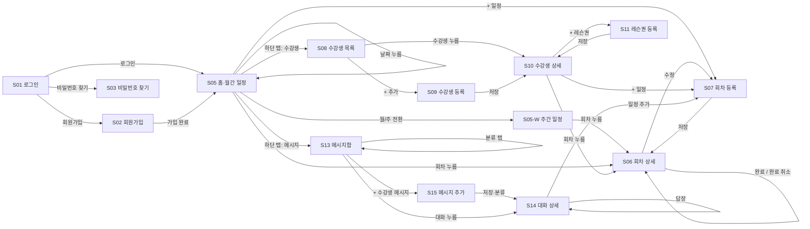

# LEMIT 화면 설계

> **상태: 초안 (2026-11-19)** · 관련 이슈: #23 · 기준: [USE_CASES.md](USE_CASES.md), [ERD.md](ERD.md)
> 발표 MVP에 필요한 화면을 정의합니다. 화면 목록의 **구현 순서** 열에서 `핵심`(핵심 시연 흐름 UC-01~07)을 먼저 만들고, `후속`(UC-08·09 휴강·보강, UC-15 비밀번호, UC-16 라벨)은 핵심이 끝난 뒤 만듭니다. 세부 우선순위는 GitHub 라벨을 따릅니다.
> 날짜 예시는 **2026-11-19(목)을 오늘**로 가정합니다.

## 1. 설계 원칙

- **PC와 모바일 모두 편하게 (반응형):** 강사는 이동 중이나 수업 직후 휴대폰으로 확인하고, 정리는 PC에서 합니다.
  - PC(1024px 이상): 왼쪽 사이드바 + 넓은 본문
  - 태블릿·모바일: 접이식 메뉴. 모바일은 폭 360px 기준으로 확인합니다.
- **홈 = 대시보드 (2026-11-20, #45):** 첫 화면에서 오늘 필요한 정보를 한눈에 봅니다. 오늘 수업, 전체 수강생, 확인할 메시지, AI 메시지 요약입니다.
  - 월간·주간 달력(S05)은 사이드바의 '수업 일정' 화면으로 옮깁니다. 일정 기능(UC-04·05)을 구현할 때 만듭니다.
  - 가장 자주 하는 일(오늘 수업 확인 → 완료 처리)은 대시보드의 '오늘의 일정'에서 두 번 터치 안에 끝나야 합니다.
- **Calm & Friendly 디자인 시스템 (§5):** 교육 서비스의 친근함과 업무 관리 도구의 정돈된 느낌을 함께 줍니다.
  - 흰색·밝은 회색 바탕에 메인 블루 하나, 연한 테두리의 카드를 씁니다.
  - TutorBird(강사 중심 관리)·Linear(목록 + 상세 패널, 배지 위계)·Calendly(날짜·시간 UI)의 원칙만 참고합니다. 화면·아이콘·로고는 베끼지 않습니다.
- **없는 기능은 만든 것처럼 보이게 하지 않습니다.** 구현 전 기능은 '준비 중'으로 표시하고, 가짜 숫자나 가짜 목록을 넣지 않습니다.
- **상태는 모양 + 글자로 구분:** 색은 라벨 전용이고, 상태는 체크·흐리게·취소선과 글자로 표시합니다 (§4). 색만으로 정보를 전달하지 않으므로 색각 이상 사용자도 구분할 수 있습니다.
- **상태 변경은 POST로 처리:** 완료·완료 취소·삭제 같은 동작은 링크(GET)가 아니라 폼(POST, CSRF 보호)으로 처리합니다.
- **화면 수 최소화:** 등록과 수정은 같은 폼 화면을 씁니다.
- **기본은 로그인 필수, 공개 화면만 예외:** 아래 "접근 정책" 참고.
- **라벨이 없어도 핵심 흐름이 동작:** 라벨(UC-16)을 만들기 전에는 모든 회차가 회색으로 보일 뿐 기능은 그대로입니다. 그래서 라벨은 후속으로 미룰 수 있습니다.

### 접근 정책

| 구분 | 화면·URL | 로그인 안 한 사용자 | 로그인한 사용자 |
|---|---|---|---|
| 공개 | S01 로그인, S02 회원가입 | 접근 가능 | 홈(S05)으로 이동 |
| 공개 | S03 비밀번호 찾기 4개 화면 | 접근 가능 | 접근 가능 (메일 링크로 들어온 경우 그대로 처리) |
| 로그인 필수 | 그 외 모든 서비스 화면·POST 동작 (S04~S15) | 로그인 화면으로 이동 (`?next=원래 주소`) | 접근 가능 |
| 별도 | `/admin/` | Django 관리자 로그인 | 관리자(`is_staff`)만 |

- **구현:** Django 5.1부터 제공하는 `LoginRequiredMiddleware`로 **모든 화면을 기본 로그인 필수**로 만들고, 공개 화면(S01~S03)에만 `@login_not_required`를 붙입니다. 새 화면을 만들 때 로그인 검사를 빠뜨려도 기본으로 막히는 방식(기본 거부)이라 실수에 강합니다. Django 기본 로그인·비밀번호 재설정 뷰는 이미 공개로 표시되어 있습니다.
- 로그인 화면은 `redirect_authenticated_user=True`로 이미 로그인한 사용자를 홈으로 보냅니다. 회원가입 화면도 같은 처리를 합니다.
- 배포 상태 확인용 `/healthz/`(#5, #32에서 구현)도 공개로 둡니다. DB·메시지 분류 모델 상태만 보여주고 개인 데이터는 없습니다.

## 2. 화면 목록

| ID | 화면 | URL | 유스케이스 | 구현 순서 | 비고 |
|---|---|---|---|---|---|
| S01 | 로그인 | `/accounts/login/` | UC-01 | 핵심 | 공개. 로그인 필수 화면에 로그인 없이 들어오면 여기로 이동 |
| S02 | 회원가입 | `/accounts/signup/` | UC-01 | 핵심 | 공개. 가입 후 자동 로그인 → 홈 |
| S03 | 비밀번호 찾기 (4개 화면) | `/accounts/password-reset/…` | UC-15 | 후속 | 공개. Django 기본 뷰: 이메일 입력 / 발송 안내 / 새 비밀번호 / 완료 |
| S04 | 비밀번호 변경 | `/accounts/password-change/` | UC-15 | 후속 | |
| S00 | 홈: 대시보드 | `/` | UC-05, UC-17 | 핵심 | 요약 카드 3개(오늘 수업·전체 수강생·확인할 메시지), 오늘의 일정, AI 메시지 요약. 일정 데이터는 UC-04·05 전까지 '준비 중' (#45, 2026-11-20) |
| S05 | 수업 일정: 월간 (기본) | 미정 (UC-05 구현 때 결정) | UC-05 | 핵심 | 달력 + 선택한 날의 회차 목록. 사이드바 '수업 일정' 메뉴. 2026-11-20에 홈(`/`)에서 분리 |
| S05-W | 수업 일정: 주간 | S05와 같은 URL에 `view=week` | UC-05 | 핵심 | 같은 화면에서 월/주 전환 |
| S06 | 회차 상세 | `/sessions/<id>/` | UC-06, (UC-08·09) | 핵심 | 상태 변경 버튼 모음. 휴강·결석 버튼은 후속 |
| S07 | 회차 등록·수정 | `/sessions/new/`, `/sessions/<id>/edit/` | UC-04 | 핵심 | 겹침·잔여 초과 경고 |
| S08 | 수강생 목록 | `/students/` | UC-02, UC-07 | 핵심 | 잔여 회차·소진 강조 |
| S09 | 수강생 등록·수정 | `/students/new/`, `/students/<id>/edit/` | UC-02 | 핵심 | 미성년자 체크 시 보호자 입력란 표시 |
| S10 | 수강생 상세 | `/students/<id>/` | UC-02, UC-03, UC-07 | 핵심 | 레슨권 카드 + 회차 이력 |
| S11 | 레슨권 등록 | `/students/<id>/enrollments/new/` | UC-03 | 핵심 | 소진된 이전 레슨권 종료 제안. 라벨 선택 칸은 후속. 보관된 수강생에게는 추가 불가 (2026-11-20 구현) |
| S12 | 라벨 관리 | `/labels/` | UC-16 | 후속 | 라벨 이름·색 추가·수정·삭제. 계정 메뉴에서 진입 |
| S13 | 메시지함 | `/inbox/`, `/inbox/?label=MAKEUP` | UC-17 | 핵심 | 대화 목록 + AI 분류 배지 + 분류 탭 필터. 하단 탭에서 진입 |
| S14 | 대화 상세 | `/inbox/<id>/` | UC-17 | 핵심 | 메시지 시간순, 수강생 메시지에 분류 배지, 답장, 열면 읽음 처리 |
| S15 | 수강생 메시지 추가 (시연용) | `/inbox/new/` | UC-17 | 핵심 | 수강생 선택 + 제목·본문 → 수강생이 보낸 메시지로 저장하고 분류 |

**화면 없이 처리하는 동작 (POST 후 원래 화면으로 돌아감)**

| 동작 | URL | 유스케이스 |
|---|---|---|
| 완료 처리 | `POST /sessions/<id>/complete/` | UC-06 |
| 완료 취소 | `POST /sessions/<id>/uncomplete/` | UC-06 |
| 회차 삭제 (`예정`만) | `POST /sessions/<id>/delete/` | UC-04 |
| 레슨권 종료 | `POST /enrollments/<id>/end/` | UC-03 |
| 수강생 보관 | `POST /students/<id>/archive/` | UC-02 |
| 수강생 보관 해제 | `POST /students/<id>/restore/` | UC-02 (잘못 보관한 경우 되돌리기, 2026-11-19 추가) |
| 로그아웃 | `POST /accounts/logout/` | UC-01 |
| 답장 보내기 | `POST /inbox/<id>/reply/` | UC-17 |
| (후속) 휴강 / 보강 등록 | `POST /sessions/<id>/cancel/`, `/sessions/<id>/makeup/new/` | UC-08, UC-09 |

## 3. 화면 흐름



**발표 시연 동선:** S01 로그인 → S08 수강생 목록 → S09 수강생 등록 → S10 상세 → S11 레슨권(8회) → S10 "+ 일정" → S07 → S05 월간 달력에서 일정 확인(주간 전환도 시연) → **S15 수강생 메시지 추가("수요일 못 가서 금요일에 보강 가능할까요?") → S14에서 "보강 요청" 배지 확인 → S13 분류 탭으로 보강 요청만 보기** → S06 완료 → S10에서 진행 1 / 잔여 7 확인

## 4. 공통 레이아웃

```text
PC (1024px 이상)                              태블릿·모바일 (1023px 이하)
+-----------+--------------------------+      +---------------------------+
| lemit.    |            (김) 로그아웃 |      | [≡] lemit.   (김) 로그아웃 |  [≡] = 접이식 메뉴
|           +--------------------------+      +---------------------------+
| 대시보드  | < 뒤로                    |      | 페이지 제목               |
| 수업 일정 | 페이지 제목      [주 동작] |      | 설명                      |
|  (준비 중)| 설명                     |      | [주 동작 (가로 꽉 차게)]  |
| 수강생    |                          |      |                           |
| 메시지함 3|      (화면 내용: 카드)    |      |   (화면 내용: 세로 배치)  |
|           |                          |      |                           |
| AI 참고용 |                          |      |                           |
+-----------+--------------------------+      +---------------------------+
```

- **사이드바:** `lemit.` 로고, 메뉴 4개(아이콘 + 글자), 현재 화면 표시(`aria-current`)를 둡니다.
  - 메시지함 옆 숫자는 안 읽은 수강생 메시지 수입니다.
  - '수업 일정'은 일정 기능 전까지 링크 없는 '준비 중' 항목입니다.
- **접이식 메뉴(1023px 이하):** 메뉴 버튼(`aria-expanded`)으로 엽니다.
  - 열리면 메뉴로 포커스가 옮겨가고, 메뉴 안에서 Tab이 순환합니다.
  - Esc·배경·닫기 버튼으로 닫으며, 닫으면 포커스가 메뉴 버튼으로 돌아옵니다.
  - JS가 꺼져 있으면 메뉴가 화면 위쪽에 펼쳐진 채로 보입니다.
- **본문 바로가기:** 첫 Tab에 나타나는 '본문 바로가기' 링크로 메뉴를 건너뜁니다.

- 처리 결과는 화면 위쪽 알림 메시지(Django messages)로 보여줍니다. 예: "완료 처리했습니다. 잔여 7회"
- 경고(겹침·회차 초과)는 노란색, 오류는 빨간색 알림을 씁니다.

### 회차 표시 체계: 라벨은 색, 상태는 모양 (2026-11-19)

한 회차에 **"무슨·누구 수업인가"(라벨)**와 **"어떻게 됐나"(상태)** 두 정보를 함께 보여줘야 합니다. 둘 다 색으로 표시하면 서로 섞여 읽기 어려우므로 **역할을 나눕니다.**

| 정보 | 표현 수단 | 누가 정하나 | 예 |
|---|---|---|---|
| 라벨 (수업 형태·사람) | **색**: 목록 왼쪽 색 막대, 달력 점 색 | 강사가 이름·색 지정 | `피아노`(파랑), `출강`(초록), `체험`(주황) |
| 상태 | **모양**: 체크, 흐리게, 취소선, 작은 글자 | 시스템 고정 | 아래 표 |

**상태 표시 (색을 쓰지 않음)**

| 상태 | 표시 |
|---|---|
| 예정 | 기본 모양 그대로 |
| 완료 | 앞에 `✓`, 글자를 회색으로 흐리게 |
| 휴강 | 제목에 취소선 + 작은 회색 글자 `휴강` |
| 결석 | 제목에 취소선 + 작은 회색 글자 `결석·차감` / `결석·미차감` |
| 보강 회차 | 작은 테두리 글자 `보강` (상태와 함께 표시) |
| 보강 필요 | **예외적으로 주황 글자** `! 보강 필요`. 강사가 처리해야 할 일이라 눈에 띄어야 함 |

```text
| 11월 19일 목요일                     |
| ▌ 15:00  이도윤 · 바이올린           |  ▌ = 라벨 색 막대 (파랑: 바이올린)
| ▌ ✓ 13:00  김하늘 · 피아노  (흐리게) |  완료
| ▌ 10:00  ~~박서연 · 피아노~~  휴강   |  휴강, 아래 줄에 "! 보강 필요"
| ▌ 17:30  정민아 · 체험  [보강]       |  보강 회차, 라벨 주황
```

**라벨을 어디에 붙이나: 레슨권**

- 레슨권(`Enrollment`)은 "누구(수강생) × 어떤 수업(레슨명)"의 묶음이라, 라벨을 여기에 붙이면 **수업 형태와 사람 구분을 모두** 할 수 있습니다.
  - 수업 형태로 쓰는 강사: `피아노`, `바이올린`, `출강`, `체험` 같은 라벨을 만들어 레슨권마다 고름
  - 사람으로 구분하고 싶은 강사: 수강생 이름으로 라벨을 만들어 그 수강생의 레슨권에 붙임
- 사람 이름은 라벨과 상관없이 **항상 글자로 표시**되므로, 라벨이 없어도 누구 수업인지는 알 수 있습니다.
- 라벨은 선택입니다. 라벨이 없는 레슨권은 회색으로 표시합니다.

**라벨 규칙**

- 이름(최대 20자)과 색(정해진 8색: 빨강·주황·노랑·초록·청록·파랑·보라·갈색 중 하나)
- 색을 자유롭게 고르게 하지 않는 이유: 너무 연한 색처럼 잘 안 보이는 색을 막고, 다크 모드에서도 같은 8색의 어두운 버전으로 바꾸기 쉬움
- 강사마다 따로 관리하며, 같은 이름의 라벨은 만들 수 없음
- 라벨을 지우면 그 라벨을 쓰던 레슨권은 "라벨 없음"(회색)이 됨. 회차 기록은 그대로
- 달력에서 라벨별로 걸러 보기 (수강생 필터와 함께)

**달력의 점:** 그날 회차의 라벨 색 점을 최대 3개까지 표시합니다. 같은 라벨은 점 하나로 합칩니다.

## 5. 디자인 가이드

**콘셉트: Calm & Friendly (2026-11-20, #45).** 처음 쓰는 강사도 쉽게 이해하고, 중요한 정보를 빨리 찾는 정돈된 화면을 목표로 합니다. 화려한 색·강한 그림자·그라데이션은 쓰지 않습니다. 구현은 `static/css/app.css`, 공통 조각 템플릿은 `templates/ui/`에 있습니다.

### 색 (CSS 변수로 중앙 관리)

| 용도 | 변수 | 값 |
|---|---|---|
| 전체 배경 | `--bg` | `#F8FAFC` |
| 카드·콘텐츠 배경 | `--surface` | `#FFFFFF` |
| 메인 블루 (주요 버튼·활성 메뉴·핵심 숫자) | `--primary` | `#4263EB` |
| 연한 블루 (활성 메뉴·정보 배지 배경) | `--primary-soft` | `#DDE9FF` |
| 연한 민트 (완료·긍정·수강 중) | `--mint-soft` | `#D9F3E7` |
| 기본 글자 | `--text` | `#273449` |
| 보조 글자 | `--text-muted` | `#6B7280` |
| 테두리 | `--border` | `#E5E7EB` |
| 주의 (휴강 요청·미성년자) | `--warning-soft` / `--warning-text` | `#FEF3C7` / `#8A4B06` |
| 오류·위험 동작 | `--danger-soft` / `--danger-text` | `#FEE4E2` / `#B42318` |

- **명도 대비:** 글자와 배경의 대비는 모두 WCAG AA 4.5:1 이상입니다(2026-11-20 계산).
  - 본문 12.5:1, 보조 글자 4.6~4.8:1, 흰 글자/블루 버튼 5.0:1, 배지 5.4~7.0:1
- **색만으로 구분하지 않습니다.** 상태와 분류는 항상 글자를 함께 씁니다. 예: `수강 중`, `보관`, `AI 보강 요청 · 97%`, `확신 낮음`

### 글자·간격·모양

| 항목 | 기준 |
|---|---|
| 글꼴 | 시스템 글꼴 (`Pretendard`(설치된 경우), `-apple-system`, `Apple SD Gothic Neo`, `Malgun Gothic`). 웹폰트를 내려받지 않음 |
| 글자 크기 | 페이지 제목 28px(모바일 24px), 요약 숫자 34px, 섹션 제목 17px, 본문 15px, 보조 13px, 배지 12px |
| 간격 | 4px 단위 (`--space-1`~`--space-8`). 카드 안쪽 24px(모바일 20px), 카드 사이 16px |
| 모서리 | 카드 16px, 버튼·입력 8px, 배지 둥근 알약 모양 |
| 그림자 | 기본 없음. 누를 수 있는 카드에만 hover 시 아주 옅은 그림자 + 테두리 색 변화 |
| 터치 영역 | 버튼·입력·메뉴 높이 최소 44px |

### 공통 컴포넌트

| 컴포넌트 | 클래스 / 템플릿 | 기준 |
|---|---|---|
| 카드 | `.card`, `.card-flush`, `.card-link` | 흰 배경, 연한 테두리. 누를 수 있는 카드는 `.card-link`(hover 효과) |
| 버튼 | `.btn` + `.btn-primary` / `.btn-secondary` / `.btn-ghost` / `.btn-danger`, 크기 `.btn-sm` | 주 동작은 화면당 Primary 하나. 되돌리기 어려운 동작은 Danger + 확인 창(`form[data-confirm]`) |
| 입력 | `templates/ui/field.html` | 라벨 위, 필수는 `*` + 화면낭독기용 '(필수)', 조건부 필수는 `(미성년자 필수)`. 오류는 빨간 테두리 + 아래 문구(`aria-invalid`, `aria-describedby`는 Django 5가 붙임). 포커스는 블루 테두리 + 옅은 블루 그림자 |
| 상태 배지 | `.badge` + `.badge-blue` / `-mint` / `-amber` / `-red` / `-violet` / `-neutral` | 짧은 글자 + 연한 배경 |
| AI 분류 배지 | `templates/inbox/_badge.html` | `AI` 표시 + 분류 이름 + 확신도. 보강 요청=블루, 휴강 요청=주의(노랑), 일정 변경=보라, 일반=회색. 확신도 0.5 미만은 점선 테두리 + `확신 낮음`, 분류 실패는 `분류 불가`. AI 예측은 참고용이라는 문구를 함께 둠 |
| 알림 | `templates/ui/messages.html` | 성공=민트, 정보=블루, 경고=노랑, 오류=빨강. 오류는 `role="alert"` |
| 빈 상태 | `.empty-state` | 아이콘 + 한 줄 제목 + 다음 행동 안내(버튼). 구현 전 기능은 '준비 중'으로 안내 |
| 아이콘 | `templates/ui/icon.html` | 직접 그린 선 아이콘(SVG, `currentColor`). 장식용이라 `aria-hidden` |

**배지 예시 (상태별 글자):** 예정·진행 중·완료는 일정 기능(UC-04~06)에서 같은 배지 컴포넌트로 추가합니다. 지금 쓰는 배지는 다음과 같습니다.
- 수강 상태: `수강 중`(민트), `보관`(회색), `미성년자`(노랑)
- 메시지 상태: `안 읽음 n`(블루), `읽음`(회색)
- AI 분류: `AI 보강 요청`, `AI 휴강 요청`, `AI 일정 변경`, `AI 일반 메시지`, `확신 낮음`, `분류 불가`
- 기능 상태: `준비 중`(회색)

**라벨 8색(UC-16)과의 관계:** 라벨 색은 레슨권 구분용입니다. 일정 화면에서 색 막대·점으로만 쓰고, 상태·분류 배지와 모양이 겹치지 않게 합니다.

### 화면별 레이아웃 (반응형)

| 화면 | PC (1024px 이상) | 태블릿 (768~1023px) | 모바일 (767px 이하) |
|---|---|---|---|
| 공통 | 왼쪽 고정 사이드바 232px | 접이식 메뉴 | 접이식 메뉴, 주 동작 버튼 가로 꽉 차게 |
| 대시보드 | 요약 카드 3열, 아래 '오늘의 일정' + '확인할 메시지' 2열 | 카드 자동 줄바꿈, 아래 1열 | 카드 세로 1열, 메시지 배지는 이름 아래 줄로 |
| 메시지함 | 2단(왼쪽 목록 380px, 오른쪽 상세 또는 '대화를 선택하세요') | 2단(목록 320px) | 목록 화면과 상세 화면 분리, 상세에 '< 메시지함' |
| 수강생 목록 | 표(이름·연락처·보호자·메모·상태) | 표 | 카드형 목록(항목 이름을 앞에 표시) |
| 수강생 상세 | 기본 정보 + 레슨권 2열, 아래 수강 종료 | 1열 | 1열 |

**CSS 방식:** 프레임워크 없이 **직접 작성**합니다. 색·간격·글자는 CSS 변수에 모으고, 공통 스타일 파일 하나(`static/css/app.css`)와 공통 동작 파일 하나(`static/js/app.js`: 접이식 메뉴, 자동 제출, 확인 창)로 관리합니다. JS가 없어도 모든 기능이 동작하는 점진적 향상 방식입니다. 달력 격자처럼 프레임워크가 제공하지 않는 화면이 핵심이고, 프레임워크의 기본 디자인을 덮어쓰는 수고가 더 크기 때문입니다.

**다크 모드:** 이번 디자인 시스템은 밝은 테마만 정의합니다. 이전 버전의 다크 모드는 제거했고, 필요하면 같은 변수에 어두운 값을 추가해 후속으로 진행합니다.

## 6. 화면별 와이어프레임

### S01 로그인 / S02 회원가입

```text
+------------------------------+
|            LEMIT             |
|    수업의 모든 흐름을 하나로    |
|                              |
| 이메일    [                ] |
| 비밀번호  [                ] |
|                              |
| [          로그인          ] |
|                              |
|    비밀번호 찾기 · 회원가입    |
+------------------------------+
```

- S02는 이메일·이름·비밀번호·비밀번호 확인 4칸. 이미 가입된 이메일이면 입력란 아래 오류 표시.
- "비밀번호 찾기" 링크는 UC-15를 구현할 때 추가합니다. UC-01에서는 "회원가입" 링크만 둡니다.
- 이메일은 대소문자를 구분하지 않습니다. 로그인 실패 메시지는 "이메일 또는 비밀번호가 올바르지 않습니다." 하나로, 가입 여부를 드러내지 않습니다.

### S05 홈: 월간 일정 (기본)

```text
+------------------------------+
| 2026년                 오늘  + |  오늘: 오늘 날짜로 이동, +: 일정 추가
| 11월                   <   >  |  달 이름 크게, < >로 이전·다음 달
|       [   월   |   주   ]     |  월/주 전환 (세그먼트 버튼)
+------------------------------+
|  일  월  화  수  목  금  토    |  일요일은 회색
|   1   2   3   4   5   6   7   |  2026-11-01은 일요일
|       .       .       .       |  회차가 있는 날 아래 점
|   8   9  10  11  12  13  14   |
|       .       .       .       |
|  15  16  17  18 (19) 20  21   |  (19) = 오늘(목): 강조색 원 안에 흰 숫자
|       .   .   .   .           |  선택한 날: 검은 원 (오늘이 아니면)
|  22  23  24  25  26  27  28   |
|       .       .       .       |
|  29  30                       |
+------------------------------+
| 11월 19일 목요일               |  선택한 날의 회차 목록
|                               |
| ▌ 15:00  이도윤 · 바이올린     |  ▌ = 라벨 색 막대, 예정은 기본 모양
|   16:00  OO초 음악실          |  종료 시각·장소는 회색 작은 글자
| ----------------------------- |
| ▌ 17:30  박서연 · 피아노       |
|   18:30                       |
+------------------------------+
| 수강생: [전체 v]               |  필터 (월·주 공통)
+------------------------------+
```

- 처음 열면 이번 달 + 오늘이 선택된 상태. 오늘 수업이 바로 아래 보여서 "회차 누름 → 완료" 두 번이면 끝남.
- 날짜를 누르면 그날 목록으로 바뀜 (`?view=month&date=2026-11-21`). 페이지 새로고침 방식이라 JS 없이 동작.
- 점은 그날 회차의 **라벨 색**으로 최대 3개까지 표시합니다 (같은 라벨은 하나로). 개수·상태는 목록에서 확인합니다.
- 목록의 각 줄은 왼쪽에 라벨 색 막대, 상태는 모양으로 표시합니다 (§4 회차 표시 체계).
- 일정이 없는 날을 누르면 "일정 없음" + `일정 추가` 버튼 (그 날짜로 미리 채워진 S07로 이동).
- 휴대폰에서 좌우로 밀어 달을 넘기는 동작은 발표 후 추가 (먼저 `< >` 버튼으로).

### S05-W 홈: 주간 일정

```text
+------------------------------+
| 2026년                 오늘  + |
| 11월 15일 - 21일       <   >  |  주는 일요일부터 (월간 달력과 같은 기준)
|       [   월   |   주   ]     |
+------------------------------+
| 11/17 (화)                    |
| ▌ ✓ 16:00 김하늘 · 피아노      |  완료: 체크 + 흐리게
|        A 레슨실               |
+------------------------------+
| 11/19 (목) 오늘               |  오늘은 강조 배경
| ▌ 15:00 이도윤 · 바이올린      |
|        OO초 음악실            |
| ▌ 17:30 박서연 · 피아노        |
+------------------------------+
| 11/20 (금)   일정 없음         |
+------------------------------+
|             ...              |
|                     [+ 일정] |  화면에 떠 있는 버튼
+------------------------------+
```

- 회차 한 줄: 라벨 색 막대, 시간, 수강생 이름 · 레슨명, 상태 표시(§4), 장소 메모(있을 때만)
- 줄을 누르면 S06. 보관된 수강생의 회차는 표시하지 않음 (기록은 수강생 상세에서 확인)

### S06 회차 상세

```text
+------------------------------+
| < 일정                        |
| 이도윤 · 바이올린 개인 레슨     |
| 11/19 (목) 15:00 - 16:00      |
| 장소: OO초 음악실              |
| 상태: 예정                     |
| 레슨권: 진행 3 / 잔여 5 (총 8) |
+------------------------------+
| [        ✓ 완료 처리        ] |  예정일 때 주 버튼
| [ 휴강 ]  [ 결석 ]    (후속)  |
+------------------------------+
| 수정 · 삭제                    |  삭제는 예정 상태만 표시
+------------------------------+
```

- 완료 상태: 주 버튼 자리에 "완료 취소" (수업일지가 있으면 숨김)
- 시작 전 회차에서 완료를 누르면 "아직 시작 전인 수업입니다. 완료할까요?" 확인
- 잔여 0인 레슨권이면 완료 후 "회차 초과" 경고 메시지

### S07 회차 등록·수정

```text
+------------------------------+
| < 일정 추가                    |
| 수강생·레슨권 [김하늘·피아노 v] |  진행 중 레슨권만. 수강생 상세에서 오면 미리 선택
| 날짜      [2026-11-21]        |
| 시작 [16:00]   종료 [17:00]   |
| 장소 메모 [A 레슨실         ] |  선택, 최대 100자
|                              |
| [           저장           ] |
+------------------------------+

저장 후 회차 상세(S06)로 이동하면서 위쪽 알림:
| 저장했습니다.                  |
| ! 같은 시간(11/21 16:00)에     |  경고는 노란 알림. 저장은 이미 끝남
|   박서연 회차가 있습니다. [수정]|  [수정]은 이 회차의 수정 화면(S07)으로
```

- **오류**(저장 안 됨, 폼에 그대로 표시): 종료 시각이 시작 시각보다 이르거나 같을 때, 선택한 레슨권이 로그인한 강사 것이 아닐 때.
- **경고**(저장은 그대로, 저장 후 알림): 시간 겹침, 잔여 초과(UC-04 기준). 한 번의 POST로 저장을 끝내고 다음 화면에서 알려주므로 "그래도 저장" 같은 두 번째 요청이 없습니다. 고치고 싶으면 알림의 [수정]을 누릅니다.
- **중복 저장 방지:** 저장에 성공하면 항상 다른 주소로 이동(POST → 리다이렉트 → GET)해서, 새로고침해도 같은 회차가 다시 만들어지지 않습니다. 저장 버튼은 누르면 바로 비활성화합니다.
- 종료 시간 기본값: 시작 + 1시간

### S08 수강생 목록

```text
+------------------------------+
| 수강생                [+ 추가] |
| [이름 검색       ] [ ] 보관 포함|
+------------------------------+
| 김하늘       피아노    잔여 7/8 |
| 이도윤       바이올린  잔여 5/8 |
| 박서연  !    피아노    잔여 2/8 |  2회 이하 강조
| 최준호  소진  기타      0/4    |  소진 배지
| 정민아       (레슨권 없음)      |
+------------------------------+
```

- 진행 중 레슨권이 여러 개면 레슨권별로 한 줄씩 표시

### S09 수강생 등록·수정

```text
+------------------------------+
| < 수강생 추가                  |
| 이름 *      [             ]   |
| 연락처      [             ]   |
| [ ] 미성년자                   |
|   보호자 연락처 * [         ]  |  체크했을 때만 표시
|   보호자 이름     [         ]  |
| 메모        [             ]   |
| [           저장           ] |
+------------------------------+
```

- 보호자 입력란 표시·숨김은 짧은 JS로 처리. JS가 꺼져 있어도 서버 검증으로 막힘.

### S10 수강생 상세

```text
+------------------------------+
| < 수강생                 수정 |
| 박서연  (미성년자)              |
| 보호자 010-0000-0000          |
+------------------------------+
| 레슨권                [+ 추가] |
|  피아노 개인 레슨 (진행 중)     |
|  총 8 · 진행 6 · 잔여 2   !   |
|  시작 2026-10-01      [종료]   |
| > 종료된 레슨권 1개            |  접힘
+------------------------------+
| 보강 필요 (후속)               |  해당 회차가 있을 때만
+------------------------------+
| 회차 이력             [+ 일정] |
| 11/19 17:30  예정             |
| 11/12 17:30  ✓ 완료           |
| 11/05 17:30  ✓ 완료           |
| ...                          |
+------------------------------+
| 수강 종료(보관)                 |
+------------------------------+
```

- 보관을 누르면 "예정 회차 N개가 삭제됩니다. 보관할까요?" 확인
- 회차 이력은 최신순, 레슨권별로 묶어 표시
- 레슨권 카드(2026-11-20 구현, UC-03): 레슨명, `진행 중`/`종료` 배지, 진행 중 레슨권이 잔여 0 이하이면 `소진` 배지(아이콘+글자, 종료된 레슨권에는 붙이지 않음), 총·진행·잔여, 시작일, 종료 버튼. 종료 확인창에 남은 잔여 회차를 알려 줌. 종료된 레슨권은 `<details>`로 접어 둠. 회차 이력은 UC-04에서 추가

### S11 레슨권 등록

```text
+------------------------------+
| < 박서연 · 레슨권 추가          |
| 레슨명   [피아노 개인 레슨   ]  |
| 총 회차  [ 8 ]                 |
| 시작일   [2026-11-19]          |
| 라벨     [● 피아노 v]          |  선택. 목록 맨 아래 "+ 새 라벨"로
|                              |  이름·색을 바로 만들 수 있음
| [v] 소진된 '피아노 개인 레슨'   |  소진된 진행 중 레슨권이
|     (0/8)을 종료합니다         |  있을 때만, 기본 체크
| [           저장           ] |
+------------------------------+
```

- 2026-11-20 구현: 레슨명·총 회차(1 이상)·시작일(기본 오늘). 종료 제안 선택지는 이 수강생의 '소진된 진행 중 레슨권'뿐이라 조작된 POST로 다른 레슨권을 보내면 폼 오류. 새 레슨권 저장과 선택한 레슨권 종료는 한 트랜잭션
- PR #55 리뷰 반영: 저장 직전에 수강생 행을 잠그고 보관 여부·선택한 레슨권의 소진 상태를 다시 확인합니다(바뀌었으면 저장하지 않고 폼 오류). 후보가 없어도 종료 칸은 검증하므로, 이미 종료됐거나 남의 레슨권을 보내면 새 레슨권을 만들지 않고 오류를 보여 줍니다.

### S12 라벨 관리

```text
+------------------------------+
| < 설정 · 라벨          + 추가 |
+------------------------------+
| ● 피아노            레슨권 3  |  ● = 라벨 색
| ● 바이올린          레슨권 1  |
| ● 출강              레슨권 2  |
| ● 체험              레슨권 0  |
+------------------------------+

라벨 추가·수정
| 이름 [출강              ]     |
| 색   ● ● ● ● ● ● ● ●         |  8색 중 하나 선택 (선택된 색에 체크)
| [           저장           ] |
| 삭제                          |  삭제 시 "레슨권 2개가 라벨 없음이 됩니다" 확인
```

### S13 메시지함

```text
+------------------------------+
| 메시지함    [+ 수강생 메시지] |  + 버튼은 시연용 (S15)
| [전체][휴강][보강][변경][일반]|  분류 탭 (AI 예측 기준)
+------------------------------+
| ● 김하늘 · 수요일 수업 관련   |  ● = 안 읽음
|   [보강 요청 82%]       14:20 |  가장 최근 수강생 메시지의 분류
|   수요일 못 가서 금요일에 …   |
+------------------------------+
|   이도윤 · 레슨 시간          |
|   [일정 변경 64%]        어제 |
+------------------------------+
|   박서연 · 교재 문의          |
|   [일반 메시지]         11/17 |
+------------------------------+
```

- 배지 색은 분류마다 다른 중립 톤을 쓰고 라벨 8색과 겹치지 않게 합니다 (라벨 색 = 레슨권, §4).
- 확신도 0.5 미만이면 `[보강 요청 · 확신 낮음]`, 분류에 실패한 메시지는 `[분류 불가]`로 표시합니다.

### S14 대화 상세

```text
+------------------------------+
| < 메시지함                    |
| 김하늘 · 수요일 수업 관련      |
+------------------------------+
| [수강생] 11/19 14:20          |
| 선생님 수요일에 학교 행사가   |
| 있어서 못 갈 것 같아요. 금요일 |
| 에 보강 가능할까요?            |
| [보강 요청 82%] AI 예측·참고용 |
|                               |
|           [나] 11/19 15:02    |  강사 메시지는 오른쪽, 분류 없음
|           네 금요일 4시 좋아요 |
+------------------------------+
| [답장 입력칸         ][보내기]|
| [수강생 상세]  [+ 일정 추가]  |  이동만 함. 일정은 강사가 직접 등록
+------------------------------+
```

- 배지 옆에 "AI 예측·참고용"을 적어 자동 처리가 아님을 알립니다.
- [+ 일정 추가]는 S07을 이 수강생의 레슨권으로 미리 선택해 엽니다. 보강 회차 연결(UC-09)은 후속입니다.
- **구현 현황 (UC-17 PR):** 회차 기능(UC-04)이 아직 없어 바로가기는 [수강생 상세]만 둡니다. [회차 보기]·[+ 일정 추가]는 UC-04 구현 때 추가합니다.

### S15 수강생 메시지 추가 (시연용)

```text
+------------------------------+
| < 수강생 메시지 추가          |
| 안내: 수강생 계정이 없는 MVP  |
|  에서 수강생이 보낸 메시지를  |
|  대신 등록하는 시연용 화면    |
| 수강생 [김하늘           v]   |  내 수강생만
| 제목   [수요일 수업 관련   ]   |  같은 수강생·같은 제목이면 기존 대화에 추가
| 본문   [                   ]   |  최대 1000자
| [           저장           ] |
+------------------------------+
```

- 저장 → 분류 → S14로 리다이렉트(PRG). 모델을 쓸 수 없으면 메시지는 저장하고 "분류 불가"로 표시합니다.

## 7. Django 앱 구조

| 앱 | 모델 | 화면 |
|---|---|---|
| `accounts` | `User` | S01~S04, 로그아웃 |
| `students` | `Student` | S08~S10, 보관 |
| `lessons` | `Enrollment`, `LessonSession`, `Label` (이후 `LessonRecord`) | S05~S07, S11, S12, 상태 변경 동작 |
| `inbox` | `Conversation`, `Message` + 분류 서비스 `classifier.py` (모델 파일은 `ml/`) | S13~S15, 답장 |

- `Enrollment`는 잔여 회차 계산이 `LessonSession`과 붙어 있어 `lessons`에 둡니다.
- S11 URL은 수강생 아래(`/students/<id>/enrollments/new/`)지만 뷰는 `lessons` 앱에 둡니다.
- **로그인:** `LoginRequiredMiddleware`로 기본 로그인 필수, 공개 화면(S01~S03)만 `@login_not_required` (§1 접근 정책).
- **데이터 소유권:** 로그인만으로는 부족하므로, 모든 조회·수정·삭제·POST 동작은 **로그인한 강사의 데이터로 좁힌 쿼리셋**에서 객체를 찾습니다 (ERD 2-5).
  - 공통 도우미는 `accounts/permissions.py`에 있습니다 (UC-01에서 추가): 뷰용 `TeacherScopedQuerysetMixin`(쿼리셋 제한, 다른 강사 객체는 404), `get_owned_or_404()`, 폼용 `TeacherScopedFormMixin`(선택지 제한). 모델마다 강사까지 가는 경로(`teacher_lookup`, 예: `student__teacher`)만 지정합니다.
  - 상세·수정·삭제: `get_object_or_404(Label, pk=pk, teacher=request.user)`처럼 강사 조건을 함께 걸어, 다른 강사의 객체 번호를 넣으면 **404**가 나오게 합니다 (존재 여부도 드러내지 않음).
  - 폼의 선택 칸(레슨권의 라벨, 회차의 레슨권 등)은 선택지 쿼리셋을 로그인한 강사 것으로 제한합니다. 조작된 POST로 다른 강사의 ID를 보내면 **폼 오류**가 됩니다.
  - 저장 직전 모델의 `clean()`에서 한 번 더 확인합니다 (예: `enrollment.label.teacher == enrollment.student.teacher`).
  - 강사 A·B 두 계정으로 서로의 데이터를 조회·수정·연결할 수 없는지 **격리 테스트**를 앱마다 둡니다.
- **Django 관리자(`/admin/`)는 운영자 전용**입니다. 강사별 범위 제한이 없으므로 강사에게 staff 권한을 주지 않습니다. 관리자 화면에서도 회차 삭제는 `예정`만 되고 일괄 삭제는 없습니다 (ERD §3, PR #55 리뷰).

## 8. 결정 기록

- [x] 모바일 우선 (2026-11-19)
- [x] ~~홈은 월간 달력 + 선택한 날 목록이 기본, 주간으로 전환 가능 (2026-11-19)~~ → 2026-11-20 홈은 대시보드(S00), 월간·주간 달력은 '수업 일정' 화면(S05)으로 이동 (#45)
- [x] ~~디자인: 아이폰 캘린더처럼 깔끔하고 직관적인 스타일 (2026-11-19)~~ → 2026-11-20 Calm & Friendly 디자인 시스템으로 변경 (§5, #45)
- [x] CSS: 프레임워크 없이 직접 작성, CSS 변수로 색·간격 관리 (2026-11-19)
- [x] 라벨(색) + 상태(모양) 표시 체계, 라벨은 레슨권에 하나 붙임 (UC-16, ERD 2-9, 2026-11-19)
- [x] 등록·수정 폼 공유, 상태 변경은 POST 동작으로 처리 (2026-11-19)
- [x] 앱 구조 `accounts` / `students` / `lessons` (2026-11-19), 메시지함 `inbox` 추가 (`messages`는 `django.contrib.messages`와 이름이 겹쳐 사용 안 함, 2026-11-19)
- [x] 메시지함(S13~S15): 메일처럼 대화 스레드, 수강생 메시지만 AI 분류, 수강생 메시지는 MVP에서 강사가 대신 등록 (UC-17, 2026-11-19)
- [x] 접근 정책: 기본 로그인 필수(`LoginRequiredMiddleware`), S01~S03만 공개 (PR #28 리뷰, 2026-11-19)
- [x] 겹침·잔여 초과는 한 번에 저장하고 다음 화면에서 경고 (PR #28 리뷰, 2026-11-19)
- [x] 구현 순서: 핵심 시연 흐름(UC-01~07) 화면 먼저, 후속(UC-08·09, UC-15, UC-16)은 그다음 (PR #28 리뷰, 2026-11-19)
- [x] 공통 레이아웃: PC 왼쪽 사이드바, 1023px 이하 접이식 메뉴, 메시지함은 PC 2단(목록 + 상세)·모바일 목록/상세 분리 (#45, 2026-11-20)
- [x] 구현 전 기능(일정)은 '준비 중'으로 표시하고 가짜 수치·목록을 넣지 않음 (#45, 2026-11-20)
